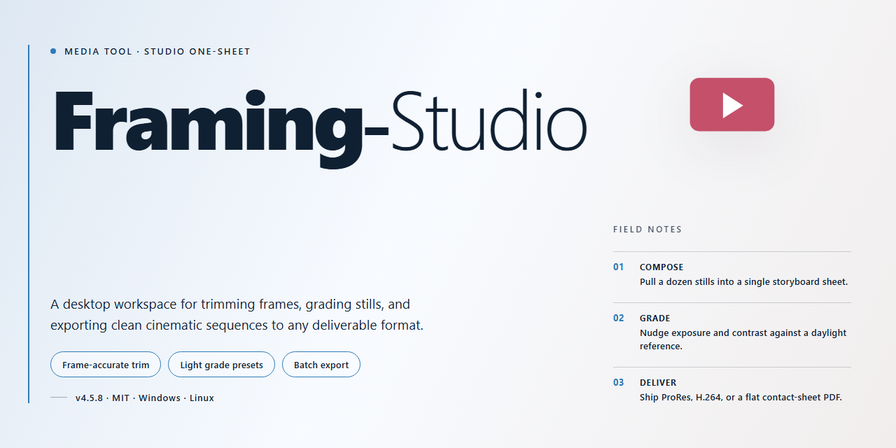

# Framing Studio: Frame, Style & Flow — Video Tool

### ⌨️ PowerShell Command Button

  

---

Framing-Studio turns ordinary digital photos into polished pieces by layering artistic frames, color treatments, and masks directly onto your images in a fluid visual workflow. Designed for Windows, this editor keeps the focus on what you see—drag a frame into place, tune the tones, and watch the composition come together without leaving the canvas. Effects like sepia, black-and-white, and color inversion sit alongside customizable frame styles, so each photo can be shaped to match your vision. Whether you are finishing a single portrait or working through a batch of shots, the workflow stays quick, visual, and free to download.

## 📋 System Requirements

- Windows 10 or Windows 11
- PowerShell 5.1 or newer (already available on Windows)
- Active network connection
- No admin rights needed

## Features

**Frames that finish the picture.** Browse a gallery of artistic borders—from clean, minimal edges to ornate, gallery-style surrounds—and drop them onto any photo in a single click. Adjust thickness, color, and corner style so the frame serves the image instead of competing with it.

**Effects that change the mood, not the memory.** Layer sepia, black-and-white, color inversion, and tonal washes over your shots to shift the atmosphere in seconds. Each effect previews live on the canvas, so you can dial intensity up or down and see exactly how the final image will read before you commit.

**Masks that put the spotlight where it belongs.** Paint a mask to isolate a subject, soften the surrounding detail, or blend an effect only into the corners. It's a fast, visual way to guide the viewer's eye without learning a stack of selection tools.

**A live canvas that keeps up with your ideas.** Every frame, tone, and mask update renders instantly, so experimentation feels like sketching. Undo and redo freely, compare variations side by side, and lock in the version that feels right.

**Batch your look across a whole shoot.** Once a frame-and-effects combination is dialed in, apply it to an entire folder of photos in one pass. Perfect for event galleries, product sets, or social posts that need a consistent visual signature.

**Presets that remember your style.** Save your favorite frame-plus-effect recipes and recall them on the next project. Your signature look stays one click away, so you spend time creating rather than re-building.

**Output built for where the image is going.** Export at high resolution for prints and displays, or size down cleanly for screens and sharing. What you see in the canvas is what lands in the file.

**A workspace that stays out of the way.** Panels are organized around the natural rhythm—open, frame, tone, mask, export—so the tools you need appear exactly when the workflow calls for them. No buried menus, no hunting for the next step.

## How It Works

Framing Studio treats every photo as a canvas waiting for its finishing touch. The process is built around a simple visual rhythm: bring an image in, dress it up, and send it back out looking gallery-ready.

**1. Bring your photo into the workspace.**
Open Framing Studio and load a single image or queue up a whole batch. Your photo lands on the main canvas, centered and ready — no digging through menus, no setup wizard. The workspace shows your picture exactly as it will look, so every adjustment you make is reflected the moment you make it.

**2. Pick a frame and watch it wrap around your image.**
Browse the frame library and click through styles. Each frame previews live on your photo, so you can compare ornate borders against clean minimal edges without committing. Adjust thickness, color, and tone with visual sliders — the frame responds instantly, letting you feel out the right balance between photo and border.

**3. Layer in effects and masks.**
Flip the mood with a single click: warm sepia, striking black and white, inverted tones, or subtle color shifts. Then use masks to guide the eye — highlight a face, soften a distracting corner, or spotlight the part of the image that matters most. Effects stack visually, and you can toggle each one on and off to see its contribution.

**4. Refine with a visual eye, not a manual.**
Everything in Framing Studio is built for previewing. Zoom in to check edge detail on a frame, zoom out to judge the overall composition. Compare before and after with a quick toggle. If something doesn't feel right, undo it and try another direction — the tool encourages experimentation rather than punishing it.

**5. Export and repeat.**
When the look is right, save your finished image at full resolution, ready for print or sharing. Working with a batch? Apply your frame-and-effect recipe across multiple photos in one pass, so an entire set carries a consistent visual signature.

The whole loop — import, frame, effect, refine, export — is designed to keep your eyes on the image and your hands off the busywork.

## Workflow

Open your chosen photograph and let the canvas become your workspace. Framing Studio lays out the image front and center, with frame collections and effect panels resting at the edges, ready to be pulled in.

**1. Bring in your image.** Load a single photo or gather a whole set; the editor keeps each file visible as a thumbnail so you always know where you are in the batch.

**2. Choose a frame.** Browse the frame library and click through options — each selection previews instantly against your actual image, not a placeholder. Adjust the frame's color tone and thickness until it sits right around the subject.

**3. Shape the focus with masks.** Paint or select the areas you want to emphasize, letting the frame and effects fade away exactly where you choose. This is where a plain snapshot starts to feel composed.

**4. Layer in effects.** Apply sepia, invert colors, or drop to black and white. Stack adjustments and watch the preview refresh in real time, tuning intensity until the mood matches your intent.

**5. Compare and refine.** Flip between the original and the edited version to judge the change honestly. Small tweaks — a warmer frame tone, a softer mask edge — often make the biggest difference.

**6. Export your result.** Save at full resolution, ready for print or screen. When working across a batch, repeat the same frame-and-effect recipe on each image to keep a series visually consistent.

The rhythm is simple: load, frame, mask, effect, compare, export. Repeat until the whole collection feels like it belongs together.

## FAQ

**Is Framing Studio really free, or am I walking into a trial maze?**

No maze, no fine print tricks. Framing Studio is a free download for Windows with the full toolset unlocked — frames, effects, masks, and all. You get the complete version, not a teaser that nags you at every export.

**Can I batch-frame a whole shoot, or is this one-photo-at-a-time?**

Think of it as a production line. Load a batch, pick your frame style, and Framing Studio applies the look across the set while keeping your originals untouched. Perfect for gallery dumps, client proofs, or a weekend's worth of family shots.

**What kinds of frames and effects are on the palette?**

You've got a full drawer of artistic frames — from clean minimal borders to elaborate decorative designs — paired with effects like sepia, black and white, and color inversion. Masks let you spotlight the subject while the rest of the frame does its thing. It's less "one-click filter" and more "compose your own look."

**Will my edits survive a print run?**

Yes. Framing Studio outputs high-resolution images built for prints and displays, so the frames and effects stay crisp when you send them to a printer or hang them on a wall. What you see on screen is what comes out of the tray.

**How does the workflow actually feel?**

Visual and direct: open an image, preview frames live, nudge colors and tones until the composition clicks, apply masks where you want attention, then export. Save your favorite combinations as presets, and the next edit becomes a two-minute job instead of a twenty-minute one.

**Does it run smoothly on my Windows machine?**

If you're on Windows 7 or later with 2 GB of RAM and about 100 MB of free disk space, you're good to go. No heavyweight hardware required — Framing Studio is built to stay out of your way and keep the focus on the image.

**Is batch processing limited by photo size?**

Nope. Whether you're working with quick snapshots or large high-resolution files, Framing Studio handles the load and keeps the output quality intact across the whole batch.

**Can I keep my original photos safe while I experiment?**

Absolutely. The editing flow is built around previews and non-destructive tweaks, so you can push frames, masks, and effects as far as you like, then dial back or start fresh. Your raw shots stay exactly as they were.

**Do updates cost extra?**

No. Regular updates roll in with new frame options, effect improvements, and performance fixes — all included, no upgrade pitch mid-project.

**Where do I go if I hit a snag?**

Start with the documentation and troubleshooting notes that ship with the project — they cover the common bumps like installation quirks, output settings, and performance tuning. Most questions get answered before you finish your coffee.

## License

Framing Studio is released under the MIT License — the same open, permissive spirit that makes the editor easy to pick up and easy to build on. Think of it as a creative commons for your workflow: you are free to use, copy, modify, merge, publish, distribute, sublicense, and sell copies of the software, provided the original copyright notice and this permission notice travel along with every copy or substantial portion of the work. In visual terms, the frame stays on the picture no matter how many times you re-export it.

The software is provided "as is," without warranty of any kind, express or implied, including but not limited to the warranties of merchantability, fitness for a particular purpose, and noninfringement. In no event shall the authors or copyright holders be liable for any claim, damages, or other liability — whether in an action of contract, tort, or otherwise — arising from, out of, or in connection with the software or the use or other dealings in the software. In workflow terms: you own the canvas, you own the choices you make on it, and you carry the results of those choices with you.

For practical use inside your own pipeline, that means you can drop Framing Studio into personal projects, client deliverables, classroom exercises, or internal tools without asking permission first. If you redistribute a modified build, keep the license text intact and note what you changed — a small caption, much like crediting a frame style, keeps the provenance visible. Attribution is appreciated but the license itself is the only requirement; there is no separate commercial tier, no per-seat count, and no hidden clause buried in the margins.

When in doubt, treat the license as the final layer in the composition: it does not change how the frames look or how the effects render, but it defines the boundaries within which the whole image can be shared. Respect the notice, keep the warranty disclaimer, and the rest of the workflow stays as open as the first export.